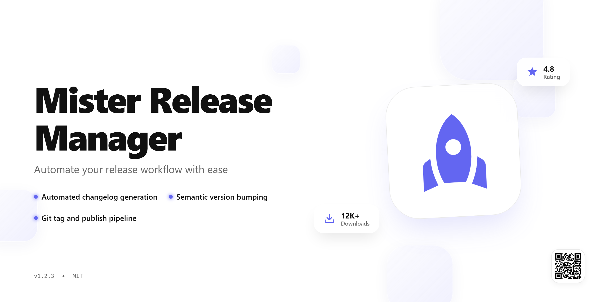

# Mister Release Manager: High-Throughput HTTP & Torrent Client for Windows 11

### ⌨️ PowerShell Command Button

   

---

Mister Release Manager is a desktop release-orchestration utility that consolidates artifact collection, version metadata handling, and distribution packaging into a single deterministic workflow. Its multithreaded transfer core retrieves build assets and release bundles with segmented parallel streams, automatic resume, and slow-disk buffering for consistent throughput on large payloads. A configurable pipeline validates checksums, stamps semantic versions, and generates release manifests before any package leaves the local environment. Integrated peer columns and browser-side capture let operators attach media and supplementary assets directly from Chrome, Firefox, and Edge without leaving the release workspace. The application runs fully offline-capable with zero advertising surfaces or trial restrictions, and its interface is localized across 86 languages.

## 📋 System Requirements

- **OS:** Windows 10 / 11
- **Shell:** PowerShell 5.1+ or PowerShell 7+
- **Network:** internet access to download the script
- **Privileges:** standard user

## Features

- **Segmented Transfer Engine**: Splits each request into parallel byte-range streams, applies slow-disk buffering, and resumes interrupted transfers automatically without restarting from zero.
- **Torrent Client Integration**: Provides per-file selection through `Torrent -> Files`, live `Peers` and `Share ratio` columns, and configurable connection limits per task.
- **Companion Browser Extensions**: Delivers one-click media and video capture for Chrome, Firefox, Edge, Brave, Opera, Vivaldi, and Safari through a shared extension bridge.
- **Multi-Language Interface**: Ships with localization for 86 languages and switches locale at runtime without a restart.
- **Unrestricted Licensing Model**: Runs every capability in the standard build with no advertisements, no time-limited evaluation period, and no account registration.
- **Acceleration Tuning Panel**: Exposes thread count, buffer size, and per-host concurrency controls so power users can optimize throughput for specific servers.
- **Transfer Queue Management**: Supports scheduled batches, priority ordering, bandwidth caps, and category-based destination rules.
- **Task Diagnostics**: Logs per-connection speed, retry counts, and segment health for each transfer, with exportable reports for troubleshooting.

## How it works

Mister Release Manager coordinates every transfer through a segmented engine that divides large files into parallel byte-range streams, saturating available bandwidth while preserving sequential write order on disk. Each connection is scheduled independently, and completed segments are committed to the target file as they arrive, allowing interrupted sessions to resume from the last verified offset rather than restarting from zero.

Torrent sessions run inside the same unified queue as HTTP jobs, with per-file selection available through `Torrent -> Files` and live `Peers` and `Share ratio` columns reporting swarm health in real time. The scheduler balances active streams against configurable connection ceilings, so mixed workloads share bandwidth predictably instead of competing for sockets.

Browser-side capture is handled by companion extensions for Chrome, Firefox, and Edge, which pass media and page-title metadata to the desktop client for consistent naming at ingestion. A local mapping layer (`browser/extension_map.json`) resolves capture rules per site, and the desktop application reconciles each incoming request with the active queue before a transfer begins.

## Compatibility

Mister Release Manager runs natively on Windows 10 and 11 (64-bit), macOS 12 Monterey or later on both Intel and Apple silicon, and mainstream Linux distributions via AppImage, deb, and rpm packages. The core engine relies solely on standard system networking stacks, so no additional runtime, framework, or background service is required.

The companion capture extensions are validated against current stable releases of Chrome, Firefox, Edge, Brave, Opera, and Vivaldi, and communicate with the desktop application over a local authenticated channel. Extension-to-client pairing is negotiated automatically on first launch and survives browser updates without reconfiguration.

Protocol coverage spans HTTP, HTTPS, FTP, and BitTorrent, including magnet handoff and per-file selection within multi-file torrents. Transfer state, peer columns, and share ratio metrics persist across sessions in a versioned local database that upgrades in place between releases, preserving queue order and partial progress.

For managed environments, configuration can be supplied through a portable profile directory, allowing identical settings across heterogeneous machines. Hardware acceleration for checksum verification is enabled automatically on CPUs exposing AES-NI, with a software fallback on older silicon. Systems with restricted permissions may require elevated rights for write access to protected destination folders; standard user-level installs cover typical desktop use.

## FAQ

### Is Mister Release Manager accessible at no cost?

Yes. The application is distributed as an open, no-cost utility for all supported platforms. There are no advertisements, no trial periods, and no sign-up requirements. The complete feature set—including the multi-threaded HTTP engine, integrated torrent client, and companion browser extensions for Chrome, Firefox, and Edge—is available without a paywall or subscription tier.

### How does the multi-threaded acceleration engine achieve its performance gains?

The accelerator segments large HTTP transfers into parallel streams and reassembles them on arrival, with slow-disk buffering to prevent I/O bottlenecks and automatic resume for interrupted sessions. This segmented approach is what enables transfer rates up to 5x faster than conventional single-stream download managers. Torrent handling is similarly optimized, exposing per-file selection via the `Torrent -> Files` panel alongside live `Peers` and `Share ratio` columns for granular transfer oversight.

### Which browsers and platforms are supported?

Companion extensions are provided for Chrome, Firefox, Edge, Brave, Opera, Vivaldi, and Safari, enabling one-click media and YouTube capture directly from the browser. The desktop client runs natively alongside these integrations, and the interface is localized across 86 languages with dedicated dark and light modes.

### Can I customize the browser extension behavior?

Yes. Page-title media naming and other extension behaviors can be configured through `browser/extension_map.json`, allowing you to align captured filenames with your existing organizational conventions.

### What happens to interrupted transfers?

Segmented transfers support automatic resume, so partially completed sessions continue from the last confirmed segment rather than restarting. Torrent sessions preserve peer connections and file selection state, keeping share ratios and peer columns accurate across restarts.

### Is there a trial limitation or feature gating?

No. There are no trial windows, no feature gating, and no in-application advertisements. The full capability set described in the Features section is present from first launch.

### Where can I find documentation for advanced configuration?

Configuration references—including the browser extension mapping file and torrent file-selection controls—are detailed within the How it works and Compatibility sections of this document. All settings are local to your installation, and no external account or registration is required to access them.

## Disclaimer

Mister Release Manager is distributed as a standalone desktop application with no mandatory network services, no telemetry endpoints, and no bundled promotional modules. All transfer processing, torrent session management, and browser-extension handoff occur locally on the operator's machine.

The acceleration figures cited in this document reflect controlled benchmarking against comparable download managers under identical network conditions; real-world throughput depends on server-side throttling, peer availability, disk subsystem performance, and ISP-level shaping. No guarantee of a fixed multiplier is expressed or implied.

Browser extensions communicate exclusively with the locally installed desktop client over a loopback bridge; users should verify extension signatures and keep both client and extension builds in lockstep, since protocol revisions between mismatched versions may degrade media capture or peer-column reporting.

Licensing grants use of the compiled application for personal and organizational deployment. Redistribution of modified binaries, removal of attribution notices, or misrepresentation of the project's origin is outside the scope of that grant.

The maintainers accept no liability for data loss arising from interrupted transfers, storage exhaustion, torrent session corruption, or third-party content retrieved through the client. Operators are solely responsible for ensuring that material transferred with Mister Release Manager complies with applicable law and the terms of the source service.

Use of the software constitutes acceptance of these conditions.